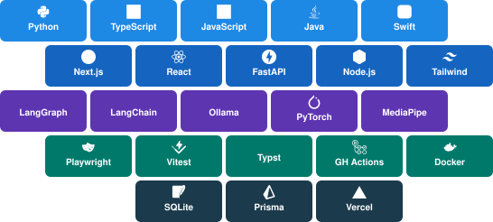

  

I'm Jayden, a Computer Science student at Wilfrid Laurier University building full-stack applications and AI developer tools.

Most of my projects start with a repetitive workflow or a claim I can't verify. I build the tool, measure whether it actually works, and publish the result — even when the numbers aren't flattering.

Currently focused on: **full-stack engineering** with Next.js and TypeScript · **backend systems** with Prisma, FastAPI, and REST APIs · **AI agent workflows** with LangGraph, LangChain, and Ollama · **testing** with Vitest and Playwright.

 

## 🚀 Shipped so far

<table>
<tr>
<td width="50%" valign="top">

🛠️ **[ResumeForge](https://github.com/ZenzerJs/ResumeForge)**
AI-assisted resume workspace with a protected master resume, Evidence Bank, mechanical guardrails against fabricated experience, deterministic ATS scoring, and in-browser Typst-to-PDF compilation via WASM. 750+ passing tests across unit, integration, and E2E suites.

</td>
<td width="50%" valign="top">

🔬 **[Ripple](https://zenzerjs.github.io/Ripple/)** · [GitHub](https://github.com/ZenzerJs/Ripple)
Reproducible volatility forecasting lab comparing eight variance models against statistical baselines on a four-ETF replay with identical trading costs and block-bootstrap stress testing. In the exploratory backtest, supervised ML did not improve portfolio utility over simpler baselines.

</td>
</tr>
<tr>
<td width="50%" valign="top">

🧪 **[Ai-Lab](https://zenzerjs.github.io/Ai-Lab/)** · [GitHub](https://github.com/ZenzerJs/Ai-Lab)
A/B experiment harness comparing governed vs. baseline coding agents on cost, runtime, and quality. Results are task-dependent — structure reduced defects on complex tasks but added overhead on simpler ones. Public SQLite telemetry and dashboard with per-task confidence intervals.

</td>
<td width="50%" valign="top">

📈 **[Stock Analyst Agent](https://stock-analyst-agent-ashen.vercel.app/)** · [GitHub](https://github.com/ZenzerJs/stock-analyst-agent)
AI equity research agent synthesizing SEC 10-K/10-Q filings, market data, and analyst sentiment into source-attributed reports via LangGraph and FastAPI, with provider fallback routing and server-side credential handling.

</td>
</tr>
<tr>
<td width="50%" valign="top">

🧙 **[Arcane-Hand-Casting](https://arcane-hand-casting.vercel.app/)** · [GitHub](https://github.com/ZenzerJs/Arcane-Hand-Casting)
Real-time browser spell-casting arena using MediaPipe WASM hand tracking and PixiJS particle rendering for gesture-driven effects — fully client-side, no server processing.

</td>
<td width="50%" valign="top">

🤖 **[Omni-Architect](https://github.com/ZenzerJs/Omni-Architect)**
Multi-agent AI orchestration: visual brief → structured specification → generated UI. Local vision extraction (DeepSeek-VL) with cloud code generation (Groq) coordinated through LangGraph.

</td>
</tr>
</table>

### 📦 Other projects

- **[WC26 Travel Mapper](https://wc26-travel-mapper.vercel.app/)** · [GitHub](https://github.com/ZenzerJs/wc26-travel-mapper) — FIFA 2026 host city planner with Mapbox routing and flight search across 16 venues
- **[Sia-Portfolio](https://shanesia-portfolio.vercel.app/)** · [GitHub](https://github.com/ZenzerJs/Sia-Portfolio) — Client creative portfolio with GSAP scroll animations and reduced-motion support
- **[ML-Stock-Simulator](https://ml-stock-simulator.up.railway.app/)** · [GitHub](https://github.com/ZenzerJs/ML-Stock-Simulator) — Educational stock forecasting with a temporal leakage audit that shaped Ripple's evaluation design

 

  

 

## 📊 Recent activity

<picture>
  <source media="(prefers-color-scheme: dark)" srcset="https://raw.githubusercontent.com/ZenzerJs/ZenzerJs/output/github-snake-dark.svg">
  <source media="(prefers-color-scheme: light)" srcset="https://raw.githubusercontent.com/ZenzerJs/ZenzerJs/output/github-snake.svg">
  
</picture>

 

**Find me elsewhere**
 

