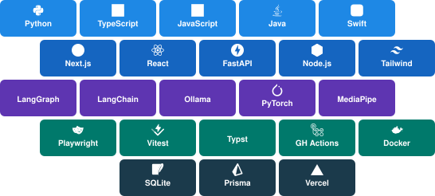

  

I'm Jayden, a Computer Science student building full-stack applications, backend systems, and verifiable AI developer tools.

Most of my projects start with a repetitive workflow or a claim I can't verify. I build the tool, measure whether it actually works, and publish the result — even when the numbers aren't flattering. Previously completed a Software Development co-op shipping an on-premises clinical software license portal; open to **Fall 2027** (and upcoming 2027–2029) full-stack, backend, and AI systems co-op roles.

Currently focused on: **full-stack engineering** with Next.js and TypeScript · **backend & data** with Prisma, FastAPI, PostgreSQL, and SQLite · **AI systems & evals** with LangGraph, Ollama, and sandboxed benchmarks · **testing & DevOps** with Vitest, Playwright, pytest, and Docker.

 

## 🚀 Shipped so far

<table>
<tr>
<td width="50%" valign="top">

🛠️ **[ResumeForge](https://resumeforge.studio/)** · [GitHub](https://github.com/ZenzerJs/ResumeForge)
Local-first AI resume workspace that tailors a write-protected master resume from verified experience records with deterministic job-match scoring, cover-letter fact verification, browser-side AES-GCM API key encryption, SSRF/IDOR hardening, in-browser Typst WASM compilation, and one-command Docker self-hosting. Validated by **1,146 Vitest** and **158 Playwright** E2E tests in CI.

</td>
<td width="50%" valign="top">

🧪 **[Ai-Lab](https://zenzerjs.github.io/Ai-Lab/)** · [GitHub](https://github.com/ZenzerJs/Ai-Lab)
Python/SQLite A/B evaluation harness comparing plain prompts against **5 structured agent architectures** (AST symbol-map injection, prompt-cached batching, split plan/execute sessions) across **7 models** and **34 multi-file benchmarks** in isolated git worktrees with hidden graders. Includes a 6-view React/Recharts analytics and cost-simulator dashboard separating billed cohorts from fixtures, backed by **475 unit tests** (501 with integration) on CI.

</td>
</tr>
<tr>
<td width="50%" valign="top">

🔬 **[Ripple](https://zenzerjs.github.io/Ripple/)** · [GitHub](https://github.com/ZenzerJs/Ripple)
Offline portfolio-replay research toolkit comparing baseline strategies against inverse-volatility allocation using variance forecasters (`scikit-learn`, `arch`) and block-bootstrap stress testing. Features a tamper-evident SHA-256 decision ledger updated daily by GitHub Actions and a Next.js static viewer (`36` Python tests + Vitest/Playwright CI).

</td>
<td width="50%" valign="top">

📈 **[Stock Analyst Agent](https://stock-analyst-agent-ashen.vercel.app/)** · [GitHub](https://github.com/ZenzerJs/stock-analyst-agent)
AI equity research agent synthesizing SEC 10-K/10-Q filings, market pricing, and analyst sentiment into claim-attributed reports via FastAPI, LangGraph, and React + Vite, with Groq/Gemini fallback routing, server-side key isolation, and a daily GitHub Actions market-data cache.

</td>
</tr>
<tr>
<td width="50%" valign="top">

🧙 **[Arcane-Hand-Casting](https://arcane-hand-casting.vercel.app/)** · [GitHub](https://github.com/ZenzerJs/Arcane-Hand-Casting)
Real-time browser spell-casting arena combining MediaPipe WASM hand tracking with PixiJS particle rendering and Vitest calibration/latency tests — fully client-side with zero server processing.

</td>
<td width="50%" valign="top">

🤖 **[Omni-Architect](https://github.com/ZenzerJs/Omni-Architect)**
Multi-agent AI orchestration (`FastAPI` + `LangGraph` backend, `Next.js` frontend) routing queries across specialized agents with local vision extraction (DeepSeek-VL), Groq cloud inference, stateful tool calling, and LangSmith tracing.

</td>
</tr>
</table>

### 📦 Other projects

- **[Stacktris](https://github.com/ZenzerJs/Stacktris)** — Zero-dependency Python CLI generating animated Tetris-style SVG skill boards (powers the board below; `84` tests across Python 3.10–3.13 CI)
- **[WC26 Travel Mapper](https://wc26-travel-mapper.vercel.app/)** · [GitHub](https://github.com/ZenzerJs/wc26-travel-mapper) — FIFA 2026 travel planner with Mapbox routing and server-side API proxies across 16 host cities
- **[Sia-Portfolio](https://shanesia-portfolio.vercel.app/)** · [GitHub](https://github.com/ZenzerJs/Sia-Portfolio) — Client creative portfolio with GSAP ScrollTrigger, Lenis smooth scrolling, and reduced-motion support
- **[ML-Stock-Simulator](https://ml-stock-simulator.up.railway.app/)** · [GitHub](https://github.com/ZenzerJs/ML-Stock-Simulator) — Forecasting sandbox with a temporal-integrity and look-ahead leakage audit that shaped Ripple's design

 

  
   
  Generated with <a href="https://github.com/ZenzerJs/Stacktris">Stacktris</a>

 

## 📊 Recent activity

<picture>
  <source media="(prefers-color-scheme: dark)" srcset="https://raw.githubusercontent.com/ZenzerJs/ZenzerJs/output/github-snake-dark.svg">
  <source media="(prefers-color-scheme: light)" srcset="https://raw.githubusercontent.com/ZenzerJs/ZenzerJs/output/github-snake.svg">
  
</picture>

 

**Find me elsewhere**
 

